# Git Graph for Claude Code

[](https://github.com/alvaromunozmx/git-graph-claude/actions/workflows/test.yml)
[](https://github.com/alvaromunozmx/git-graph-claude/releases/latest)
[](LICENSE)

A Git Graph pane for Claude Code, in Claude Desktop and in the terminal: your branches, tags and remotes laid out in lanes, like the VS Code extension, next to the conversation.

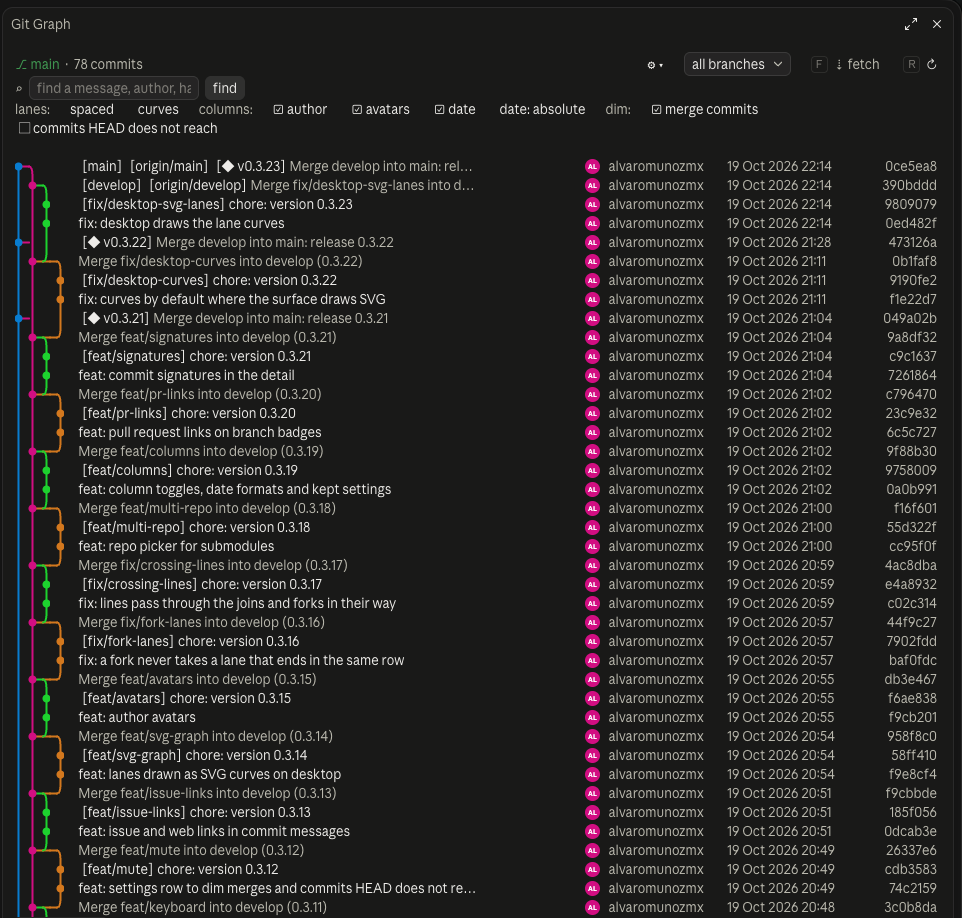

## Requirements

- **Claude Code 2.1.287 or later in the terminal, or 2.1.286 or later in Claude Desktop's Code tab.** Git Graph is a *mod*: a plugin with a hooks module, and Claude Code runs mods by default from those versions (`/status` in the Code tab shows its version). It is tested on 2.1.299 (Claude Desktop) and 2.1.304 (terminal). Mods don't load under `--safe-mode`, with `"disableAllHooks": true` in your settings, or where your organization lets only its own mods load: then the plugin installs but `/git-graph` does not appear.
- **git** on the `PATH`, and a folder inside a git repository (submodules are picked from the repo picker).
- **Claude Desktop's Code tab or the Claude Code terminal.** It is not tested in Cowork.
- Nothing else to install: no Node, no build step. Node 22.6+ is only needed to develop it (see Development).

## Install

In a terminal session:

```text
/plugin marketplace add alvaromunozmx/git-graph-claude
/plugin install git-graph@git-graph-claude
```

Or from a shell:

```text
claude plugin marketplace add alvaromunozmx/git-graph-claude
claude plugin install git-graph@git-graph-claude
```

In Claude Desktop's Code tab, where `/plugin` does not run: click **+** next to the prompt box, then **Plugins**, **Add marketplace** with `alvaromunozmx/git-graph-claude`, then **Add plugin**. A plugin installed from a terminal at the user scope loads there too.

Don't upload `git-graph.zip` in Settings → Plugins → Upload a plugin: that reaches Cowork, not the Code tab.

Then run `/reload-plugins` (or start a new session) and `/git-graph`.

### If `/git-graph` doesn't appear

1. Run `/reload-plugins`, or start a new session: a session loads its plugins when it starts.
2. Run `/plugin` and look for an error next to `git-graph`; `claude plugin list` from a shell shows whether it is installed and enabled.
3. Check your Claude Code version: `claude --version` in a shell, `/status` in Claude Desktop's Code tab. Mods need 2.1.287 in the terminal and 2.1.286 in Claude Desktop.
4. In a terminal, `/plugin` shows a dim `mods active` line naming the mods the session loaded. If `git-graph` isn't there, check for `--safe-mode`, for `"disableAllHooks": true` in `~/.claude/settings.json`, and whether your organization lets only its own mods load.

## Use

- `/git-graph` opens the pane: commits laid out in lanes, with the checked-out branch, local and remote branches and tags (◆) as badges, plus author, date and hash. It adapts to the pane's width.
- **The header** has two lines. The first says where the repo stands (`⎇ main`, how many files have uncommitted changes, how many commits are drawn), with the branch picker, **⇣ fetch**, **↻** and **⚙ settings** on the right. The second finds (**⌕** and the find field) on the left and walks the rows on the right: **↑ ↓** for the previous and next commit and **HEAD** for the commit HEAD points at. A narrow pane wraps each line's right side under its left.
- A finished action (checkout, merge, push…) says so in a toast, since the pane already shows what it changed. The line under the header keeps errors, until the next action, and what is under way (`fetching…`).
- **⌕** and the find field keep only the commits whose message, author, hash or branch and tag names hold the text, lit where they match. **✕ clear** shows them all again.
- **Uncommitted Changes** get a row of their own (○) above the commit they would follow. Click its `*******` (where a commit has its hash) to list the changed files; **✎ commit…** has Claude propose a message and commit them, and **⊟ stash…** stashes them, untracked files included, with an optional message.
- **Stashes** (◈) fork off the commit they were made on, while every branch is drawn. Open one to **apply** it, **pop** it, make a **branch…** from it or **drop** it.
- **⚙ settings** opens the settings, kept between sessions, as a panel with a line per group:
  - **Lanes**: **spaced / compact** (with a gap, or side by side) and **curves / glyphs** (in Claude Desktop the lanes are SVG curves and dots by default, like Git Graph; the terminal draws them with box-drawing glyphs).
  - **Columns**: **author**, **avatars** (each author's initials on their own color; real pictures would need network access the pane does not have), **date**, and the date as **absolute** (`19 Oct 2026 10:00`), **relative** (`3 hours ago`) or **iso** (`2026-10-19 10:00`).
  - **Dim**: **merge commits** (on by default, like Git Graph) and **commits HEAD does not reach**.
- **The repo picker** appears when the repo has submodules checked out: pick one to draw its history, with every action working there.
- **The branch picker** shows every branch, only the current one, or any one branch alone, local branches listed apart from remote ones (also `/git-graph all` and `/git-graph current`). Where the surface has no picker, a button toggles all and current.
- **⇣ fetch** fetches every remote, with its tags, pruning the branches deleted there.
- **↻** reloads. The graph also reloads on its own whenever Claude finishes a turn.
- **Keys**, while the pane has the focus: `j` and `k` (**↓ ↑**) open the next and the previous commit (turning the page at its edges; with none open, the first of the page), `h` (**HEAD**) the one HEAD points at, `s` (**⌕**) goes to the find field, `f` fetches, `r` reloads, `Esc` closes the pane. Tab and the arrows walk the buttons. Under the pointer, each header button says what it does and which key presses it.
- **Click a branch or tag badge** to open its actions under the row:
  - a branch: **checkout**, **merge into current**, **rebase current onto this**, **rename…**, **push** (setting its upstream), **delete** (asking again before it deletes unmerged commits), **copy name**; **pull from origin/…** moves it to its upstream, fast-forward only, checked out or not, and a line says what a push and a pull would move (`↑1 to push, ↓2 to pull · origin/main`).
  - on GitHub, GitLab or Bitbucket, a branch other than the remote's default also links to **↗ pull request into** that default branch.
  - a remote branch: **checkout** (a local branch tracking it), **merge into current**, **rebase current onto this**, **fetch**, **delete on remote**.
  - a tag: **checkout** (detached), **merge into current**, **push tag**, **delete tag**.
- **Click a hash** to open the commit under its row, titled with its hash and quick links (copy hash, copy subject, its page on the web), its actions as buttons in groups: what looks around, what changes the current branch, what deletes. A button waiting for its confirming press is drawn as the primary one. Under them: author, date, message and changed files. A signed commit says who signed it and whether git trusts the signature (GPG or SSH, as git is set up to check them). Each file shows its status (A, M, D, R) and the lines it added and deleted, and the commit its totals. **Click a file** to read its diff right there (merges against their first parent), and again to close it:
  - **↗ github.com** (or gitlab.com, bitbucket.org) opens the commit's page. In the message, `#123` links to that issue or pull request and web addresses are links.
  - **⇄ compare…** marks it; every commit opened next lists the files that changed between the two, older to newer, each with its diff (the uncommitted row compares too). **✕ stop comparing** in the header ends it.
  - **copy hash** and **copy subject** to the clipboard.
  - **checkout**: its local branch; or a new local branch tracking its remote one; or a detached HEAD.
  - **new branch here**: asks Claude, who asks you for the name and applies its own permissions.
  - **tag…**: opens a field under the commit. `v1.2` makes a lightweight tag, `v1.2: message` an annotated one.
  - **cherry-pick** onto the current branch.
  - **revert**: a new commit that undoes it (a merge against its first parent).
  - **merge into current**: merges its branch, or the commit itself, into the current branch.
  - **rebase current onto this**.
  - **reset current to this**: then pick **soft** (keep the changes staged), **mixed** (keep them unstaged) or **hard** (discard them).

### In motion

Opening a commit: its quick links (copy the hash or the subject, its page on GitHub), its actions, its message and files, and **+ Branch…**, which hands the task to Claude.

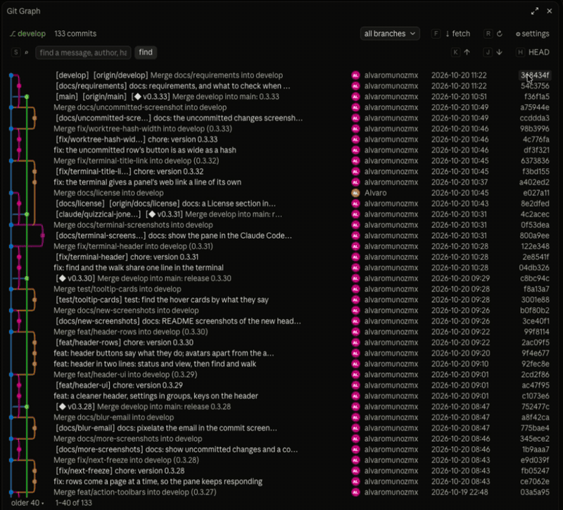

The branch picker, with local branches apart from remote ones, and a branch opened from its badge: how it stands against its upstream and what it can do.

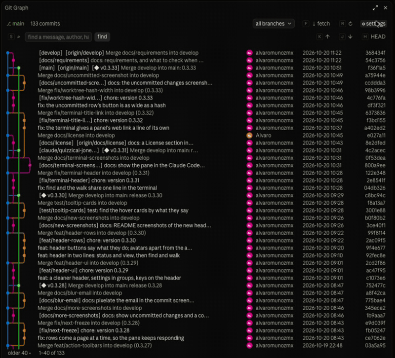

The header's buttons, which say what they do under the pointer, and the settings: lanes, columns, date format and what is dimmed.

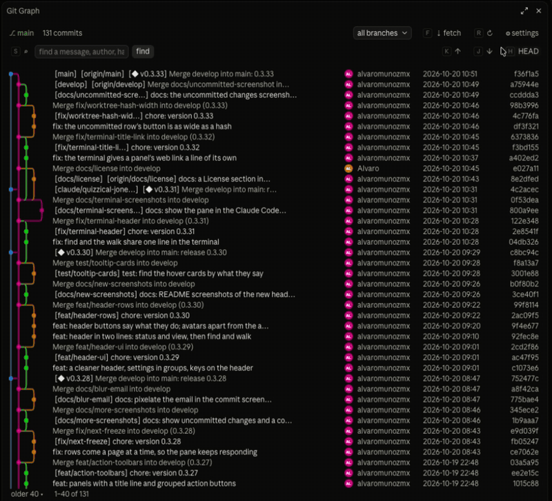

A branch's panel and a commit's open together, the lanes going on beside them.

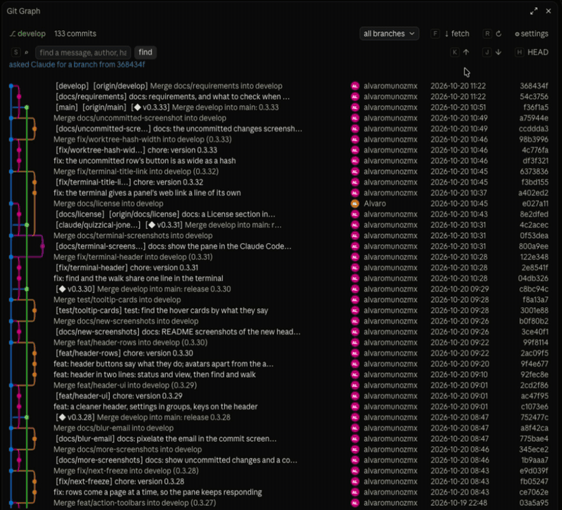

### Screenshots

Uncommitted changes, opened from their `*******`: the files changed in the working tree, with **✎ Commit…**, **⊟ Stash…** and **⇄ Compare**, here with a new file's diff open.

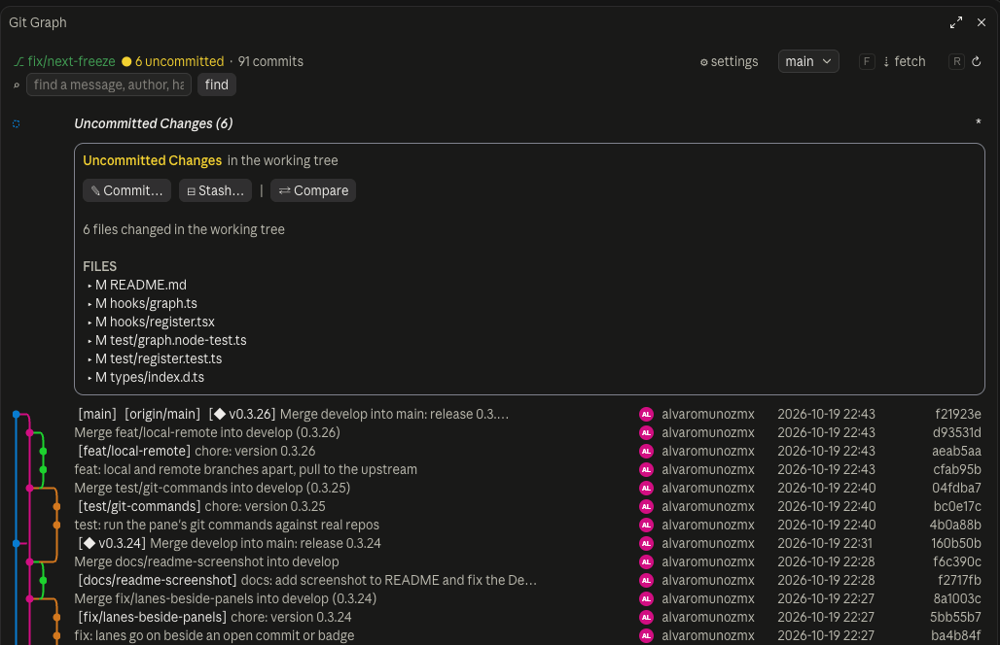

A commit, opened: its actions in groups, the author and date, its lines added and deleted, its message with links, and its files, each opening its diff.

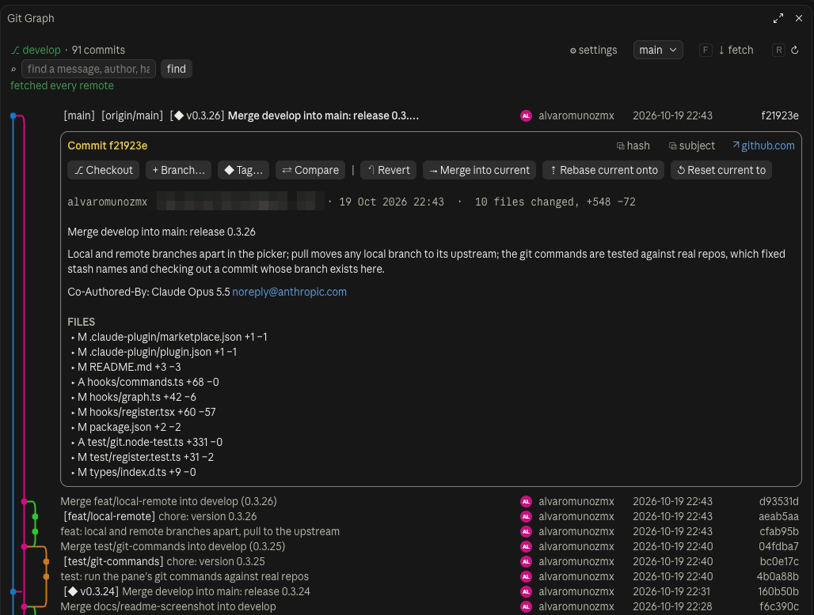

A branch, opened from its badge: how it stands against its upstream, a link to open a pull request, and its actions.

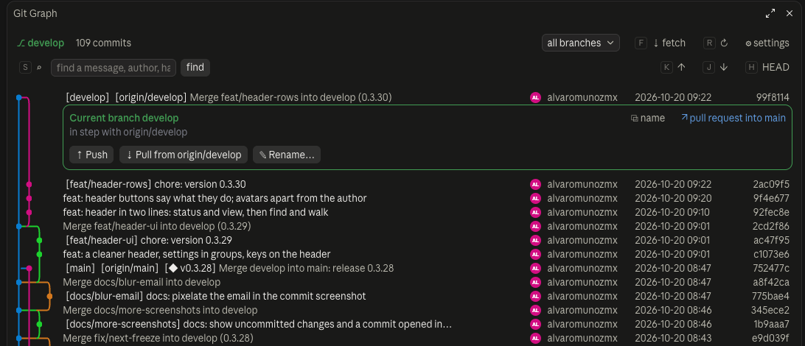

The settings, open under the header: a line per group.

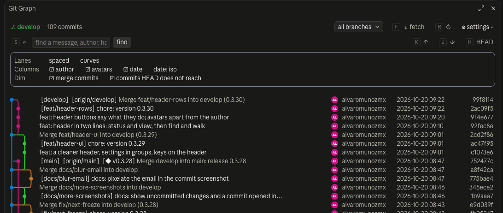

In the terminal, the same pane draws its lanes with box-drawing characters, which join from row to row there, and each key shows beside its button (`s:`, `k:`, `j:`, `h:`, `f:`, `r:`).

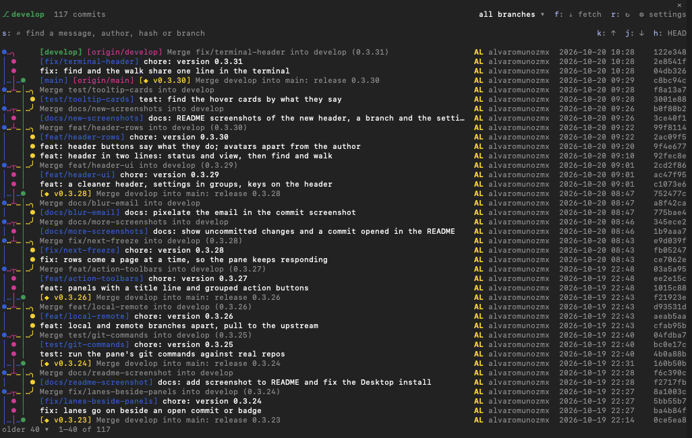

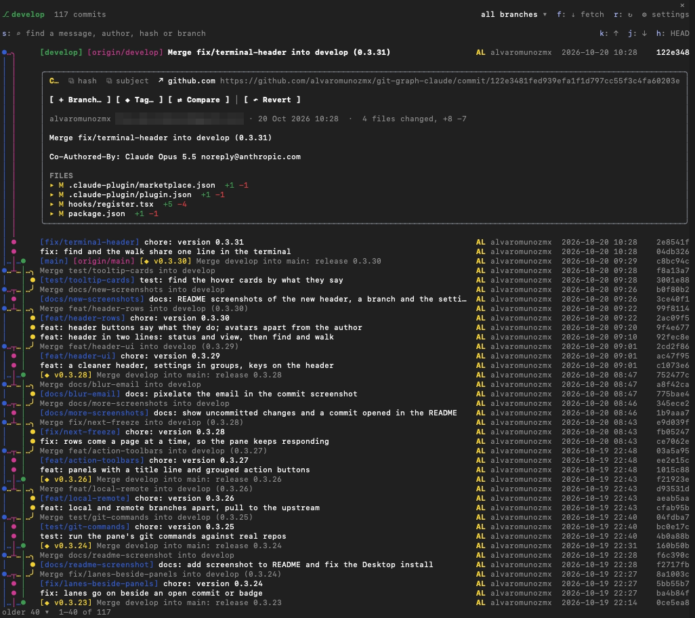

Actions that change the repo need a second click to confirm and wait for Claude to finish its turn. They refuse to run with uncommitted changes, except a soft or mixed reset. A cherry-pick, revert, merge or rebase that stops on a conflict is undone, leaving everything as it was.

## Settings

`limit`: how many commits to load (150 by default). They are drawn a page of 40 at a time: **older ▾** and **▴ newer** turn the page.

## How it works

It is a Claude Code *mod*: [`hooks/register.tsx`](hooks/register.tsx) registers `/git-graph`, opens a pane and draws it, and listens to `turn.complete` to reload. [`hooks/graph.ts`](hooks/graph.ts) reads `git log` and lays commits out in lanes; it does not depend on Claude Code.

## What it runs and sends

Like every mod, Git Graph runs on your machine with your permissions. It has no server and no telemetry, and makes no network request of its own. `claude plugin validate .` lists every hook it registers and every call it makes.

- **git.** Everything it shows and does is a `git -C <repo> …` command, run with `GIT_TERMINAL_PROMPT=0` so git never waits for a password. It reads (`log`, `status`, `diff`, `show`, `branch`, `tag`, `stash list`, `remote`…) when the pane opens, when you press **↻** and when Claude finishes a turn. It changes the repo only when you press a button, and checkout, merge, rebase, cherry-pick, revert, reset, push, pop and every delete wait for a second, confirming press. Every command that changes the repo or a remote is in [`hooks/commands.ts`](hooks/commands.ts).
- **Network.** Only git reaches the network, and only when you press **fetch**, **pull**, **push**, **push tag** or **delete on remote**: to the remotes your repo already has, with the credentials git already uses.
- **Clipboard.** **copy hash**, **copy subject** and **copy name** run `uname -s`, then `pbcopy` (macOS), `wl-copy`, `xclip` or `xsel` (Linux) or `clip` (Windows) through `sh -c` or `cmd /c`, with the text in an environment variable.
- **Prompts to Claude.** **✎ commit…** and **new branch here** send Claude a prompt in the current session, as if you had typed it. Claude then works under its own permissions and asks you before it commits or names the branch. Nothing else goes to Claude or to a model.
- **What it keeps.** Your settings (lanes, columns, dimming, date format), in Claude Code's store for the plugin, on your machine. Nothing about your repos.
- **Links.** The **↗** links (a commit's page, a pull request, `#123` in a message) are built from your first remote's address and open in your browser only when you click them. Avatars are initials drawn in the pane, not pictures fetched from the web.

## Development

| Command | What it does |
| --- | --- |
| `npm run test:node` | The lane layout's tests, with Node's test runner |
| `npm run validate` | `claude plugin validate .` |
| `npm run test:mod` | `claude plugin test .` |
| `npm run zip` | `dist/git-graph.zip`, ready to upload in Claude Desktop |

To release: `npm version patch` (or `minor`, `major`) bumps `package.json`, `plugin.json` and `marketplace.json` together and tags the commit; `git push --follow-tags` publishes a GitHub release with the zip. Users update with `/plugin marketplace update git-graph-claude`.

## Changes

Every version and what it changed is in [CHANGELOG.md](CHANGELOG.md). To report a bug or ask for something, [open an issue](https://github.com/alvaromunozmx/git-graph-claude/issues/new/choose).

## License

[MIT](LICENSE) © Alvaro Muñoz
